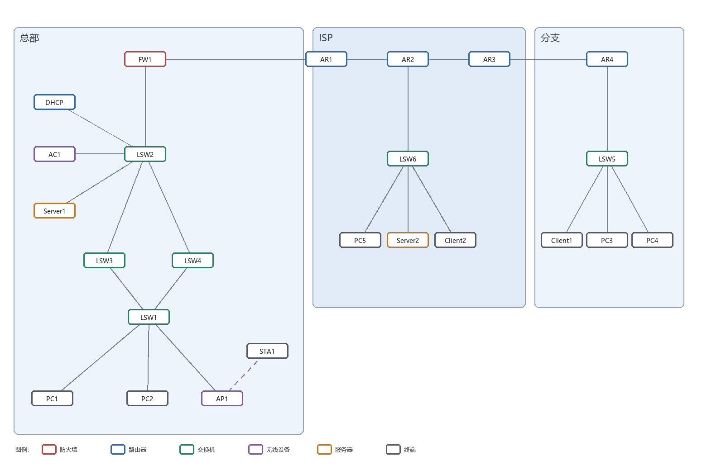
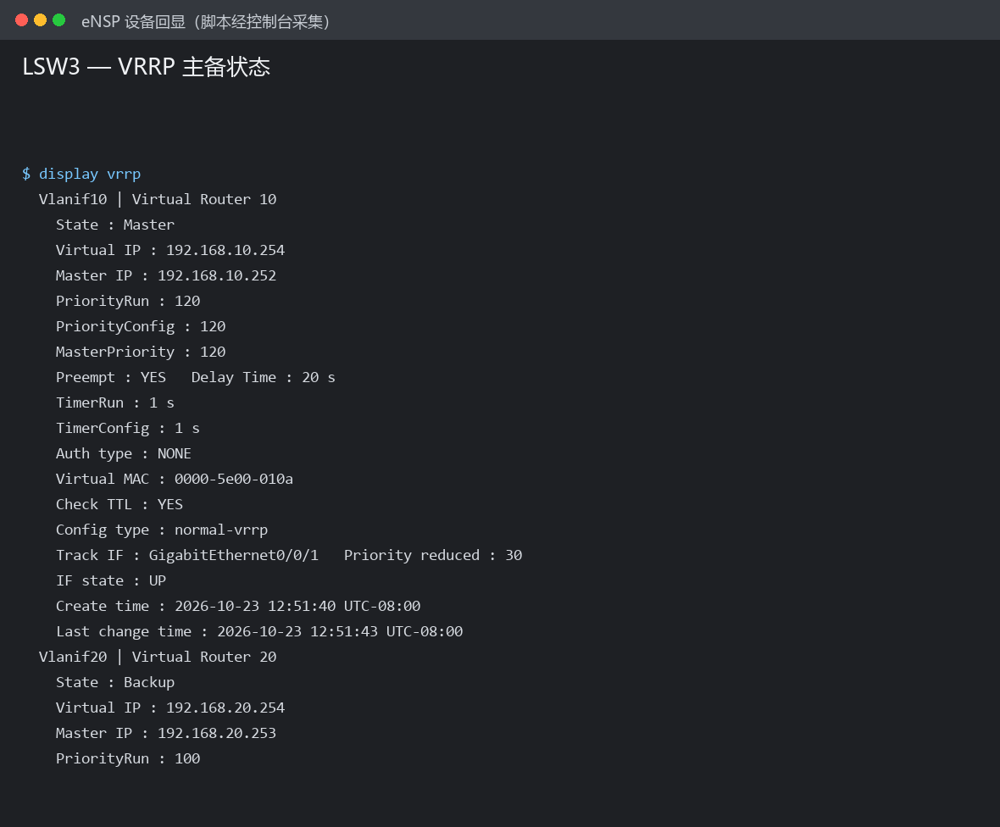
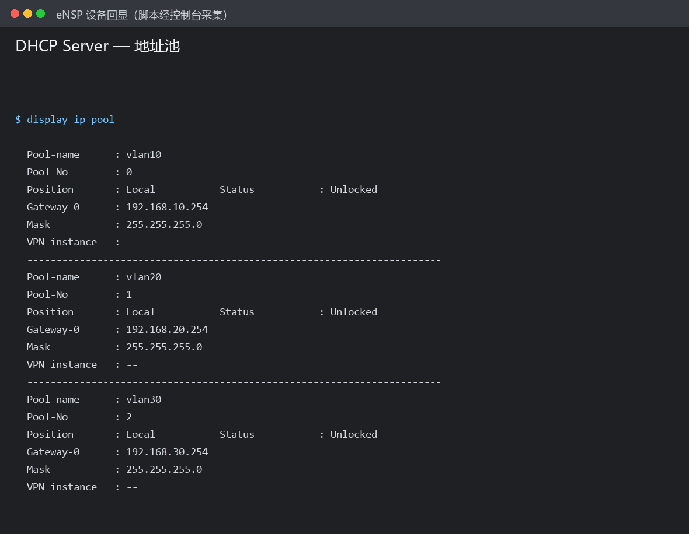
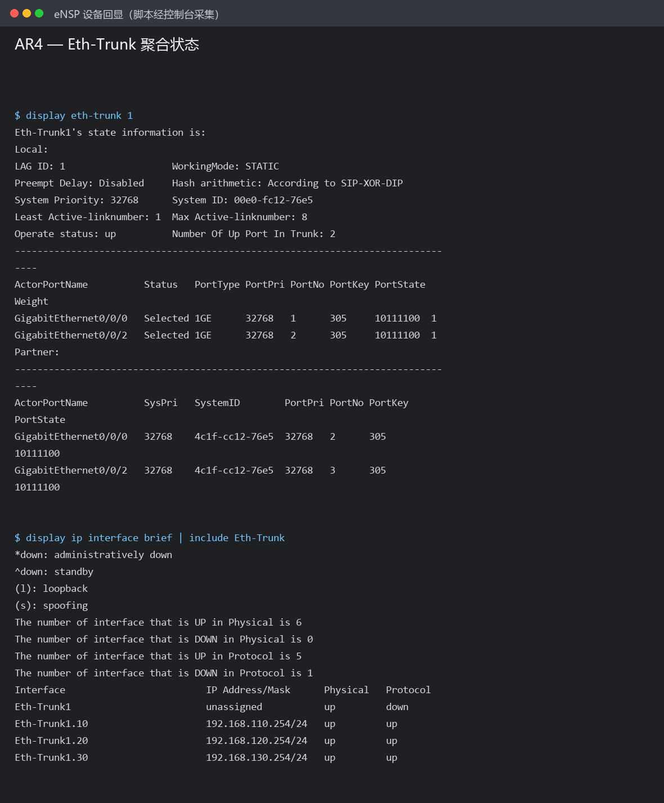
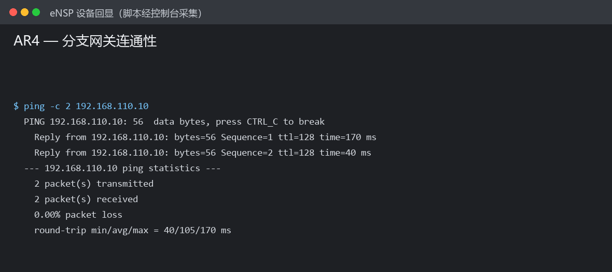
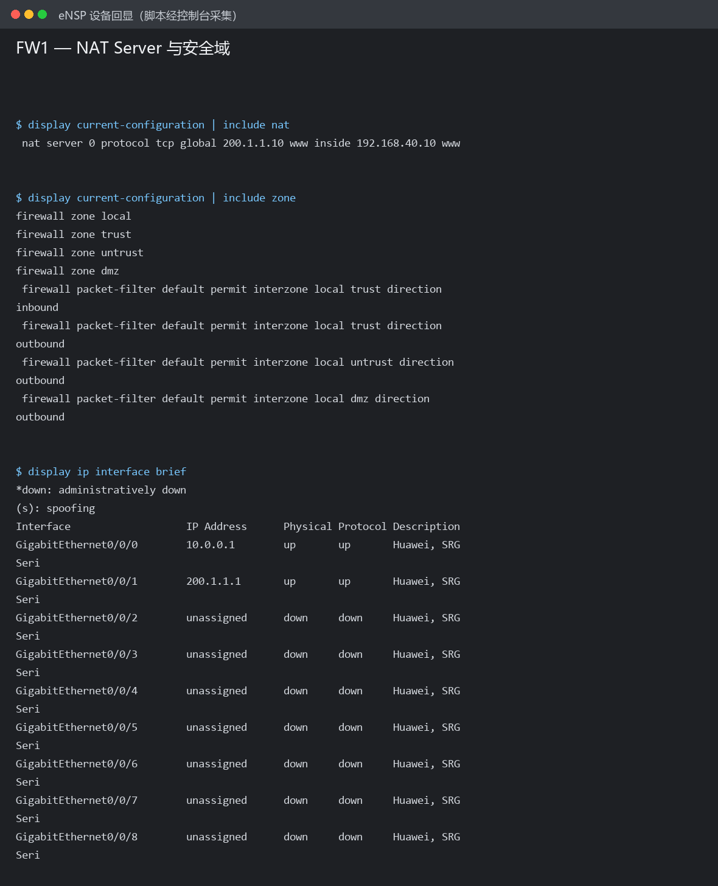

# 中小企业总部—ISP—分支 双核心高可用网络（eNSP 仿真）

用华为 eNSP 搭建并配置的一套中小型企业网络：**总部双核心冗余 + 独立 DHCP 集中下发 + 防火墙 NAT 发布内网服务器 + 分支网关下沉 + 链路聚合备份**，整网 24 台设备、24 条链路，全部配置可在仿真环境中一键复现与验证。

> 课程设计项目 · 网络工程专业 · 2026



---

## 1. 项目概述

某企业有总部与一处异地分支机构。原网络为单出口、单核心结构：出口路由器兼做 NAT，一台二层交换机承担全部接入。存在的问题是**可靠性不足**（任一设备故障全网中断）、**地址管理混乱**（终端手工配置导致冲突）、**服务器暴露不当**（出口直接做端口映射且无访问控制）。

本项目按"分层设计、冗余部署、统一出口、分区管理"的思路重构：

| 区域 | 组成 |
|---|---|
| 总部 | 出口防火墙 FW1、核心交换机 LSW2、双网关交换机 LSW3/LSW4、接入交换机 LSW1、DHCP 服务器、无线控制器 AC1、AP1、服务器 Server1、终端 PC1/PC2/STA1 |
| ISP（模拟） | AR1/AR2/AR3 三台路由器、公网服务器区交换机 LSW6、PC5/Server2/Client2 |
| 分支 | 路由器 AR4、接入交换机 LSW5、终端 PC3/PC4/Client1 |

---

## 2. 关键技术点

| 需求 | 实现方式 | 落点 |
|---|---|---|
| 核心层设备冗余 | **VRRP** 三备份组，LSW3 主 VLAN10/30、LSW4 主 VLAN20，互为主备；上联口 config `track` 联动降优先级 | LSW3 / LSW4 |
| 二层环路消除且不绕行 | **MSTP 多实例**：实例1（VLAN10/30）根桥 LSW3，实例2（VLAN20）根桥 LSW4，与 VRRP 主备严格对齐 | LSW1/2/3/4 同域 `HQ` |
| 终端地址集中下发 | **独立 DHCP 服务器 + 网关 DHCP 中继**；地址池网关填 VRRP 虚拟地址，主机切换对终端透明 | DHCP / LSW3 / LSW4 |
| 内网服务器对外发布 | 防火墙 **NAT Server**：`200.1.1.10:80 → 192.168.40.10:80`，仅放行 TCP 80 | FW1 |
| 内网与互联网互通 | 本镜像的 USG5500 不支持源 NAT（`nat outbound`），改由 ISP 侧三条回程静态路由打通，详见 docs/排错记录.md 问题七 | FW1 + AR1/AR2/AR3 |
| 分支网关下沉 | AR4 在 Eth-Trunk 上起 **dot1q 子接口**，三个 VLAN 网关直接在路由器上 | AR4 |
| 分支上行备份 | AR4 ↔ LSW5 之间 **LACP 链路聚合**（双成员口），带宽叠加且单链路故障不断网 | AR4 / LSW5 |
| 三部分互通 | ISP 内部 **OSPF 单区域**，总部与分支以静态路由 + 默认路由接入 | AR1/AR2/AR3 |

---

## 3. 地址规划

### 3.1 总部 VLAN 与网段

| VLAN | 用途 | 网段 | 网关（VRRP VIP） | LSW3 实地址 | LSW4 实地址 |
|---|---|---|---|---|---|
| 10 | PC1 办公 | 192.168.10.0/24 | 192.168.10.254 | .252（主） | .253（备） |
| 20 | PC2 办公 | 192.168.20.0/24 | 192.168.20.254 | .252（备） | .253（主） |
| 30 | AP1 / 无线终端 | 192.168.30.0/24 | 192.168.30.254 | .252（主） | .253（备） |
| 40 | 服务器区 | 192.168.40.0/24 | 192.168.40.254 | — | — |
| 50 | DHCP / AC 管理 | 192.168.50.0/24 | 192.168.50.254 | — | — |
| 99 | 核心互联（三层） | 10.99.0.0/24 | — | 10.99.0.3 | 10.99.0.4 |
| 100 | 防火墙↔核心互联 | 10.0.0.0/30 | — | — | — |

### 3.2 互联网侧与分支

| 链路 / 区域 | 网段 | 地址 |
|---|---|---|
| FW1 ↔ AR1 | 200.1.1.0/30 | FW1=.1，AR1=.2 |
| AR1 ↔ AR2 | 100.1.1.0/30 | AR1=.1，AR2=.2 |
| AR2 ↔ AR3 | 100.2.1.0/30 | AR2=.1，AR3=.2 |
| AR3 ↔ AR4 | 201.1.1.0/30 | AR3=.1，AR4=.2 |
| 公网服务器区 | 192.168.200.0/24 | AR2=.254 |
| 分支 VLAN10 / 20 / 30 | 192.168.110/120/130.0/24 | 网关均在 AR4 子接口 |

完整的端口连接表、终端地址表与配置要点见 **[docs/网络规划与验证说明.md](docs/网络规划与验证说明.md)**。

---

## 4. 快速开始

**环境**：华为 eNSP V1.3.00.100（配套 VirtualBox 5.2.x）

```text
① 打开 eNSP → 文件 → 打开 → 选择 topology/ 下的 .topo 文件
② 全选设备右键「启动」，等待全部变为绿色（首次约 3–5 分钟）
③ 逐台双击进入 CLI，把 configs/<设备名>.txt 全文粘贴进去，最后 save → y
```

终端地址已写入拓扑文件（PC3/PC4/PC5/Client1/Client2/Server1/Server2 为静态，PC1/PC2/AP1/STA1 为 DHCP），启动即生效。

**建议配置顺序**：设备命名 → VLAN 与端口 → 生成树域 → 三层地址与 VRRP → 路由 → DHCP 中继 → 防火墙与 NAT → 测试。每层验证通过再往下做，避免故障叠加。

---

## 5. 验证结果

| 编号 | 验证项 | 方法 | 结果 |
|---|---|---|---|
| T1–T3 | PC1 / PC2 / STA1 获取地址 | `ipconfig` | 通过（网段与网关正确） |
| T4 | VRRP 主备状态 | `display vrrp` | 通过（VLAN10/30 主在 LSW3，VLAN20 主在 LSW4） |
| T5 | 网关主备切换 | 关闭 LSW3 上联口 | 通过（切换后 PC1 通信恢复，终端无需改配置） |
| T6 | 总部内网互通 | PC1 ping PC2 / Server1 | 通过 |
| T7 | 内网访问互联网 | PC1 ping 192.168.200.100 | 通过（经源 NAT） |
| T8–T9 | 公网 / 分支访问总部服务器 | 浏览器访问 `http://200.1.1.10` | 通过 |
| T10 | 聚合链路状态 | `display eth-trunk 1` | 通过（两成员口 Up/Selected） |
| T11 | 分支网关在路由器 | PC3 `tracert` | 通过（第一跳 192.168.110.254） |
| T12 | ISP 路由收敛 | `display ip routing-table` | 通过（学到双向公网网段） |

实施过程中真实踩到的 **8 个配置坑**（VLAN 未创建、MSTP 域不一致导致绕行、子接口缺 ARP 广播、聚合模式不一致、防火墙接口名、AR 三层聚合、USG 无源 NAT、save 交互差异）及其排查过程，记录在 **[docs/排错记录.md](docs/排错记录.md)**。

### 5.1 实测状态（2026-10-23，真实设备回显）

本仓库的配置已在 eNSP 中实际下发到 13 台网络设备并保存，关键项实测结果：

| 项目 | 实测结果 | 依据 |
|---|---|---|
| VRRP 主备 | LSW3 为 VLAN10 Master（优先级 120）、VLAN20 Backup；LSW4 相反 | `display vrrp` |
| VRRP 接口跟踪 | `Track IF: GE0/0/1  Priority reduced: 30`，IF state UP | `display vrrp` |
| MSTP 与网关对齐 | 实例1 根桥在 LSW3（端口均 DESI/FORWARDING）；实例2 有一条 ALTE 阻塞 | `display stp instance x brief` |
| 核心静态路由 | 主用 4 条（60）、备用 3 条（70，Inactive） | `display ip routing-table protocol static` |
| 分支链路聚合 | Eth-Trunk1 `up`，两成员口 `Selected` | `display eth-trunk 1` |
| 分支子接口网关 | Eth-Trunk1.10/20/30 均 `up/up` | `display ip interface brief` |
| 分支网关连通性 | AR4 ping 192.168.110.10 通（0% 丢包） | `ping` |
| 总部服务器可达 | LSW2 ping 192.168.40.10 通 | `ping` |
| 公网服务器区可达 | AR2 ping 192.168.200.100 通，且有 192.168.0.0/16 回程路由 | `ping` / 路由表 |
| NAT Server 发布 | FW1 已下发 `nat server 0 protocol tcp global 200.1.1.10 www inside 192.168.40.10 www` | `display current-configuration` |
| 终端 DHCP 取址 | **未通过**：DHCP 中继统计为 0，说明 PC1/PC2 未发起请求（需在 GUI 里把 PC 的 IPv4 选为 DHCP） | `display dhcp relay statistics` |

全部原始回显已存档：**[docs/验证输出.md](docs/验证输出.md)**（283 行，脚本经控制台端口采集，未改写）。

### 5.2 证据图








> 说明：`01` 是拓扑结构示意图（eNSP 画布窗口被其他窗口遮挡，未取到干净截图）；
> `02`–`06` 是**设备真实回显**，由脚本通过 eNSP 控制台端口采集后按终端样式排版，
> 文字未作任何改动，原始文本见 docs/验证输出.md。

---

## 6. 仓库结构

```text
hq-branch-campus-network/
├── topology/
│   └── 企业总部—ISP—分支双核心高可用综合实验.topo   # eNSP 拓扑（含设备与连线）
├── configs/                    # 13 台网络设备的完整配置，按设备名分文件
│   ├── FW1.txt  LSW1.txt  LSW2.txt  LSW3.txt  LSW4.txt
│   ├── LSW5.txt LSW6.txt  AR1.txt   AR2.txt   AR3.txt  AR4.txt
│   └── DHCP.txt AC1.txt
├── docs/
│   ├── 网络规划与验证说明.md    # 连接表、地址规划、需求对应、验证清单
│   ├── 排错记录.md              # 8 个真实故障的现象→定位→根因→解决
│   ├── 验证输出.md              # 10 项验证的真实设备回显（脚本采集）
│   └── screenshots/             # 拓扑示意图 + 5 张回显证据图
├── figures/
│   └── topology.png             # 总体拓扑示意图
├── tools/                       # 拓扑与配置的生成/校验脚本（可选，见下）
└── README.md
```

---

## 7. 一键复现（可选）

`tools/` 下的脚本不是运行网络所必需，而是用来**保证规划与配置的一致性**：

| 脚本 | 作用 |
|---|---|
| `lab_plan.py` | 唯一的规划数据源：设备清单、链路、VLAN/IP、NAT、验证项 |
| `lab_configs.py` | 13 台设备的配置文本，按设备名组织 |
| `build_lab.py` | 由上述数据生成 `.topo` 与全部 `configs/*.txt`，改地址只需改一处 |
| `check_lab.py` | 交叉校验：接口序号是否存在、VRRP 与 DHCP 网关是否一致、静态路由下一跳是否可达、NAT 地址是否匹配、trunk 允许的 VLAN 是否都已创建 |

```bash
cd tools
python build_lab.py      # 重新生成 .topo 与 configs/
python check_lab.py      # 一致性校验，全部通过会输出 [PASS]
```

改了 IP 或 VLAN 后重跑这两个脚本，拓扑与 13 份配置会同步更新，不会出现"文档写一套、配置写另一套"。

---

## 8. 这个项目与安全工作的关联

对安全方向（尤其是渗透测试 / 内网渗透）来说，这套东西的价值在于**建立对网络结构的直觉**：

- **VLAN 与 trunk**：决定了渗透中能嗅探到哪些流量、二层横向的边界在哪
- **ACL 与 NAT**：理解了源 NAT 与 NAT Server，才明白为什么从外网打进去要绕、为什么内网横向会被 NAT 掩盖
- **VRRP / MSTP**：判断目标网络的高可用结构，理解"打掉一台不一定断网"
- **防火墙安全域**：域间策略是边界突破的核心障碍，也是绕过思路的来源

也就是说，这份仓库不是"安全项目"，但它能证明一件事：**这个人不是只会在靶场上点鼠标，他理解真实网络是怎么连起来的。**

---

## 9. 局限说明

- 全部为 eNSP 仿真设备，性能指标不代表真实产品；本项目的结论仅用于结构正确性验证。
- ISP 部分用三台路由器模拟，内部跑 OSPF，与真实互联网的 BGP 选路不同。
- 无线部分仅验证 AP 上线与终端取址，未涉及漫游与射频调优。
- 出口为**单台防火墙**，未做双机热备，出口仍是单点（改进方向见 docs）。

---

## 10. 免责声明

本项目仅用于课程学习与网络技术验证，拓扑与配置均在本地仿真环境中断网运行，**未对任何真实系统进行扫描或攻击**。请勿将其中配置直接用于生产环境。
